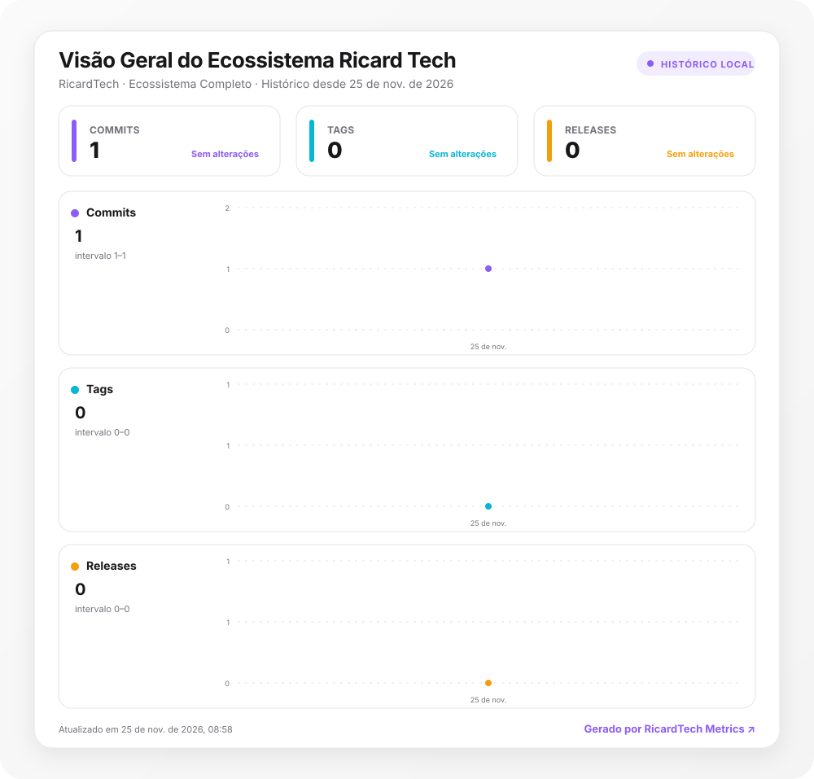

<p align="center">
  
</p>

<h1 align="center">Métricas do Ecossistema Ricard Tech</h1>

<p align="center">
  <strong>Hub centralizado de métricas e gráficos de crescimento multi-cloud para o ecossistema Ricard Tech.</strong>
</p>

<p align="center">
  <a href="https://github.com/alaxricardsilva/ricardtech-metrics/releases/tag/v1.0.0"></a>
  <a href="https://github.com/alaxricardsilva/ricardtech-metrics/actions"></a>
  <a href="https://git.ricardtech.top/RicardTech/ricardtech-metrics"></a>
  <a href="https://gitlab.com/alaxricard/ricardtech-metrics"></a>
  <a href="LICENSE"></a>
</p>

---

## 🚀 Sobre o Projeto

O **RicardTech Metrics** coleta, agrega e projeta o crescimento de todos os mais de 60 repositórios sincronizados entre **GitHub**, **GitLab** e **Forgejo** (`git.ricardtech.top`).

Em vez de poluir cada projeto individual com crons e bots gerando commits diários, este hub central:
1. Consulta as APIs das três plataformas 2x ao dia no fuso horário de Brasília (`America/Sao_Paulo`).
2. Agrega as métricas reais:
   - ⭐ **Estrelas**: Soma consolidada de GitHub + GitLab + Forgejo.
   - 🍴 **Forks**: Soma dos forks de cada plataforma.
   - 📦 **Downloads de Releases**: Soma consolidada dos downloads de assets.
3. Gera gráficos vetoriais SVG adaptativos (Dark / Light Mode) para cada repositório em `charts/<slug>.svg`.
4. Gera um painel consolidado global em `charts/overview.svg`.
5. Mantém o histórico dia a dia em `data/<slug>.json` sem dependências de bancos externos.

---

## 📌 Como exibir nos 60+ Repositórios

No `README.md` de qualquer repositório da Ricard Tech, basta colar o snippet abaixo (substituindo `<nome-do-repo>` pelo nome do repositório em minúsculas):

```html
<p align="center">
  <a href="https://github.com/alaxricardsilva/ricardtech-metrics">
    .svg" alt="Métricas do Repositório" />
  </a>
</p>
```

---

## ⚙️ Execução Local

```bash
# Executar a suíte de testes unitários
node --test test/*.test.js

# Executar a coleta manual de métricas
node src/index.js

# Injetar badges nos repositórios locais
python3 scripts/inject-badges.py
```

---

## 🛡️ Licença

Distribuído sob a licença MIT. Consulte o arquivo `LICENSE` para mais detalhes.
